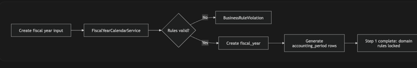

# Period Lifecycle and Numbering Rules

## Fiscal Year Rules

1. Fiscal year date ranges must not overlap.
2. Only one fiscal year can be current and open at a time.
3. Start date must be first day of month; end date must be last day of month.
4. Standard fiscal year contains 12 periods.
5. If a fiscal year is closed, all periods under it are closed and locked.

## Period Status Rules

- open: all operational postings allowed.
- soft_closed: AP/AR/Inventory postings blocked, GL adjustments allowed.
- closed: no postings allowed.
- periods under a closed fiscal year cannot be reopened.

Allowed transitions:

- open -> soft_closed
- open -> closed
- soft_closed -> open
- soft_closed -> closed
- closed -> (none)

## Numbering Rules

- Numbering is unique per (module, document_type).
- Format: PREFIX-YYYY-000001 (default).

### Reset Policy

- never: numbers do not change
- fiscal_year: numbers reset to 1 for each fiscal year
- period: numbers reset to 1 for each period (month)
