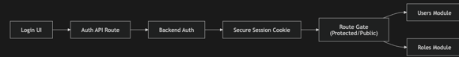
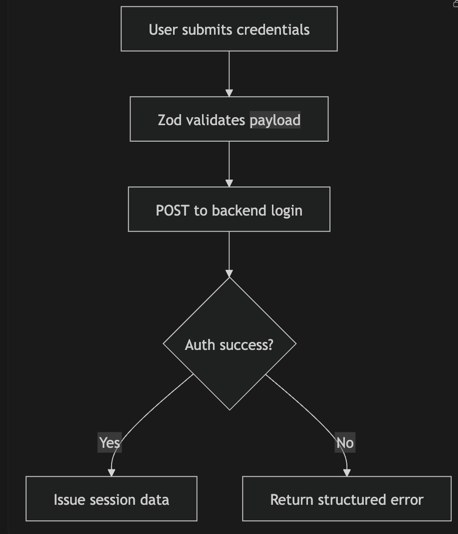
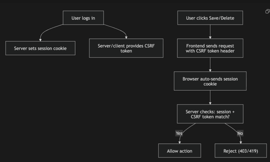
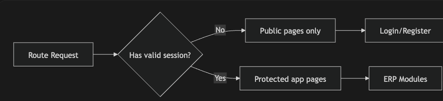
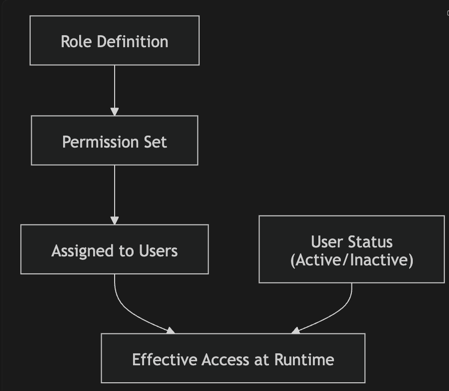
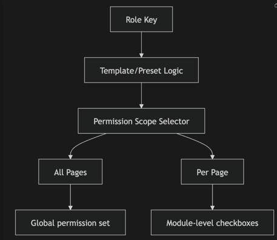

# Weekly Briefing

**Scope:** Login security, session management, route gating, and Users/Roles scaffolding  
**Date:** March 3, 2026

---

## Summary

**Key accomplishments**
- Connected login flow frontend to backend pattern.
- Enforced safer cookie-session plus CSRF-aware flow.
- Added protected/public route gating pattern.
- Delivered Users and Roles admin scaffolding with standardized operations.

---

## Secure Login Pipeline

**What was implemented**
- Structured login request validation (Zod).
- Backend authentication handoff through frontend API layer.
- Consistent error handling for failed credentials and invalid payloads.  ≠

---

## Session + CSRF Security

**What was implemented**
- Cookie-based session strategy.
- CSRF token pattern for mutation safety.
- Consistent logout/session invalidation behavior.

---

## Protected vs Public Routing

**What was implemented**
- Public route grouping and protected route grouping.
- Redirect/gate behavior aligned for unauthorized access.
- Cleaner route governance for future modules.
       

---

## RBAC Architecture Decision
**What was implemented**
- Centralized access controls in Roles.
- Users module focused on assignment and account status.
- Standardized terms: Active/Inactive and Activate/Deactivate.

---

## Roles Module (Policy Control)
**What was implemented**
- Dynamic permission section driven by role key.
- Access scope modes:
  - All Pages
  - Per Page
- Module/action checkbox matrix.

---

## Fiscal Year / Period Management Improvements
**What was improved**
- Strengthened direction for period/fiscal-year validation before posting.
- Clarified expected lifecycle behavior for open/close transitions.
- Reduced risk of posting to invalid or restricted periods.

---

## Weeks Checklist
**What was delivered**
- Auth payload validation and mutation error normalization.
- Cookie-session and CSRF pattern integration.
- Protected/public route gating pattern.
- Users/Roles module scaffolding with reusable state-management patterns.
- Terminology standardization and UI consistency improvements.

---

## Next weeks plan
**Recommendations**
1. Enforce role permission checks server-side on all protected mutations.
2. Add audit trail for role changes, user status changes, and assignment changes.
3. Add immutable/template system roles and conflict checks.
